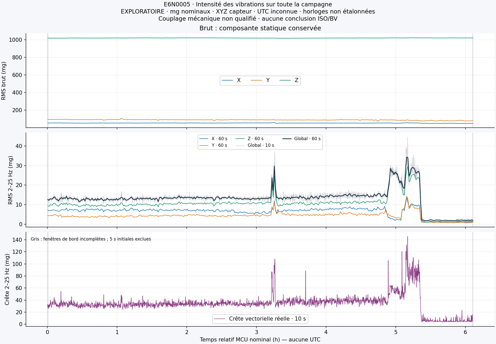
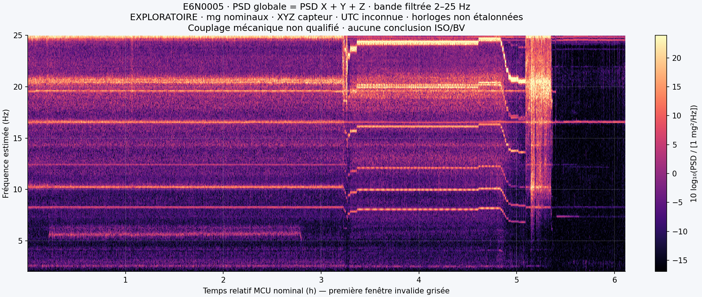
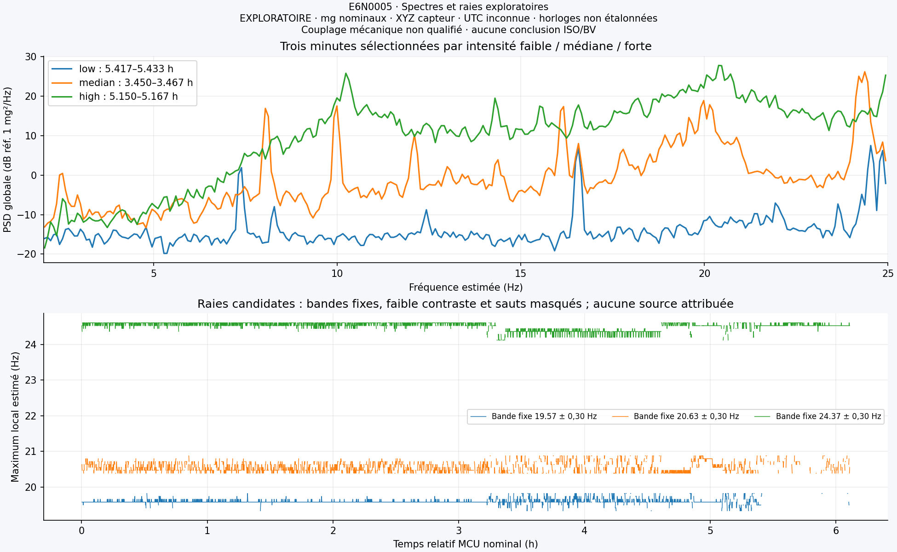

# TR2 — objectiver les vibrations au PC machine

**Premiers résultats exploratoires calculés sur la campagne du31octobre2026.**
Restitution technique interne ; revue indépendante ChatGPT encore à effectuer.
Ce POC ne constitue pas une expertise de conformité ou de confort humain.

## 1. Ce que les six heures apportent

Le fichier réel contient58552136 triplets XYZ et passe les contrôles stricts
CRC/indices/session/footer. Le témoinPC prouve une période active d'au moins
6h00min01s. Une coupure a effacé la référence indépendante du digestRAM avant
sa lecture : l'intégrité interne est démontrée, la chaîne producteur→carte au
sens industriel reste réservée. Montage expérimental au plancherPCmachine,
fixation au double-face annoncée, axes du navire non établis.

## 2. Intensité : résultat prioritaire

Les valeurs suivantes sont **calculées à sensibilité nominale** dans la bande
Butterworth2–25Hz, après exclusion warmup/stabilisation, sans pondération de
confort. Fenêtres complètes de60sMCU ; temps et fréquence non étalonnés.

| Indicateur | Valeur |
|---|---:|
| RMS global médian par minute |13.36mg|
| RMS global P95 par minute |25.64mg|
| Maximum du RMS global par minute |34.40mg|
| Maximum du RMS global par10s |44.58mg|
| Crête vectorielle filtrée maximale |145.64mg|
| Couverture bandefiltrée, en nombre d'échantillons |99.9773%|

Le brut conserve une moyenneXYZ d'environ(51.33;−88.07;1018.62)mg : une
composante statique importante coexiste avec des vibrations beaucoup plus faibles.
Ce constat ne constitue pas un étalonnage de la pesanteur. Le filtre supprime
la composante constante ; ses bornes sont à−3.01dB, donc ce RMS n'est pas celui
d'une bande rectangulaire idéale.

Au-dessus du P90 interne15.345mg, cinq épisodes regroupent37minutes, soit10.14%
des365minutes complètes retenues. Le plus long est de17580à19260sMCU, soit
28minutes. Le seuil sert uniquement à repérer les périodes relativement fortes
de cette campagne, **pas à déterminer une gêne ou un dépassement réglementaire**.

## 3. Fréquences : expliquer les changements

Des raies et des transitions de niveau/fréquence sont visibles. Trois bandes
candidates sont suivies autour de19.57,20.63 et24.37Hz estimés, avec ruptures
conservées et puissances tracées séparément. Il ne s'agit pas d'identités de
machines. Les intervallesfaible19500–19560s, médian12420–12480s et fort18540–18600s
sont choisis par le niveau calculé, sans inventer un régime d'exploitation.

Aucun ancrageUTC qualifié ni journal externe synchronisé n'est disponible.
La différence de bases de tempsPC/MCU d'environ0.68% interdit de traiter les
binsFFT comme une précision métrologique. Les annotations sont relativesMCU.

## 4. Ce que permettrait un pilote borné

Les résultats sont archivés en SQLite local et en CSV, sans millions d'XYZ en
base. Le traitement est reproductible ; un réimport identique ne duplique pas
les séries. L'étape suivante utile est une qualification courte avec fixation
rigide, axes documentés et référence étalonnée, incluant1Hz et la base de temps.

Les tests mathématiques accélération→vitesse1–80Hz passent sur signaux
synthétiques. Wm et l'indicateur normatif ne sont pas implémentés ; aucun grade
BV/ISO ni indice d'exposition n'est attribué. Il faudra verrouiller les éditions
applicables, qualifier filtre/intégration, pose et comparaison indépendante.

La trame métier publiée sert de cadre de restitution ; aucun budget n'est
inventé. Les moyens d'un pilote (fixations/boîtier, alimentation/connectique,
référence étalonnée, temps d'essais et points représentatifs) restent à chiffrer
sur devis et à décider humainement. Les vibrations seules ne prouvent ni fatigue
structurelle, ni défaut attribuable à un équipement, ni dommage futur.
