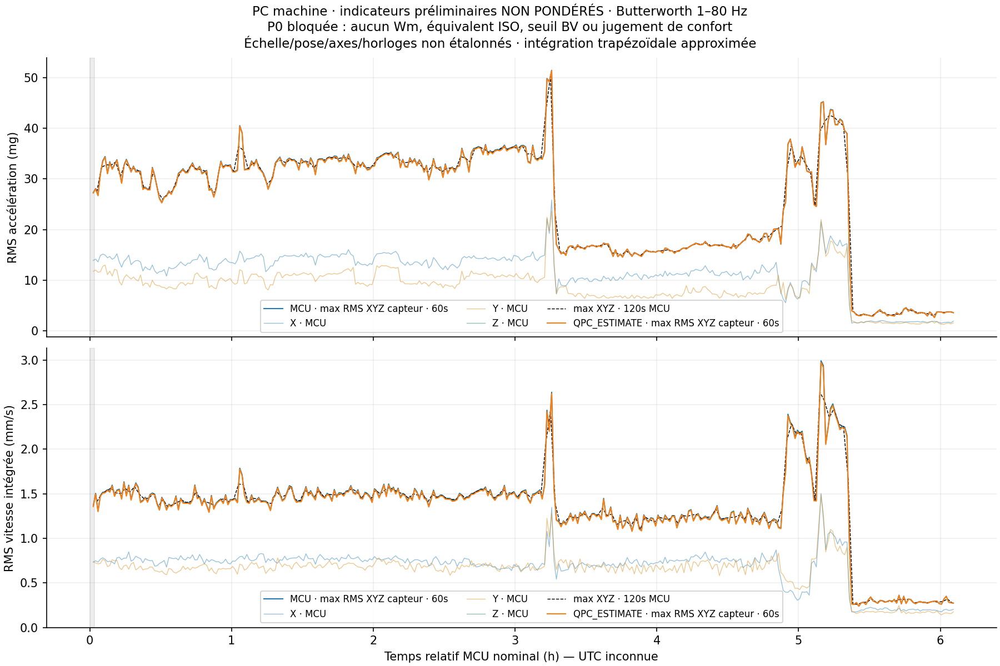

# PC machine — première vitesse physique exploratoire

**Calcul réel non pondéré ; aucun verdict de confort.**

Les XYZ originaux des six heures ont été traités avec un passe-bande Butterworth1–80Hz et une intégration physique stable distincte. Le maximum des RMSX/Y/Z est retenu par fenêtre de60/120sMCU ; il ne s’agit pas du vecteur global, ni d’une sélection étalonnée de directions navire.

|Indicateur et hypothèse|Fenêtre|P50|P95|Maximum|
|---|---:|---:|---:|---:|
|mg · MCU|60s|31.137|36.789|51.410|
|mg · MCU|120s|31.436|36.556|50.309|
|mm/s · MCU|60s|1.424|2.197|2.990|
|mm/s · MCU|120s|1.430|2.169|2.641|
|mg · QPC_ESTIMATE|60s|31.003|36.697|51.343|
|mg · QPC_ESTIMATE|120s|31.316|36.397|50.235|
|mm/s · QPC_ESTIMATE|60s|1.415|2.182|2.970|
|mm/s · QPC_ESTIMATE|120s|1.420|2.154|2.623|

Une valeur supérieure traduit une plus forte vibration filtrée selon cette méthode. Ces valeurs ne prouvent ni gêne humaine, ni bonne ou mauvaise acceptabilité du local. Elles ne doivent pas être comparées à des repèresBV de vitesse pondérée. Wm et la grandeur équivalenteISO ne sont pas implémentées faute d’accès autorisé aux définitions complètes ; la mission est donc bloquée sur sa porteP0.

La base secondaire conserve2204résultats sans modifier les49134métriques antérieures. Les deux scénarios de cadence sur les mêmes fenêtres rendent visible la sensibilité au choix d’horloge ; ils ne constituent pas un budget d’incertitude complet. Sensibilité, fixation et axes non étalonnés ; UTC inconnue ; réserve historique de digestRAM perdue maintenue. Aucune causalité machine, grade de navire, exposition A(8) ou conséquence structurelle n’est inférée.

La prochaine action indispensable est l’accès licite aux clausesISO20283-5§7/8.1 et annexeA, à l’annexeA Wm de l’édition applicable2631-2 et à l’oracle/tolérances8041, avant implémentation pondérée et éventuelle comparaison indicative. Le futur essai physique de pose/axes/cadence/réponseà1Hz est une autre mission. Aucun achat ou essai n’est déclenché ici.
