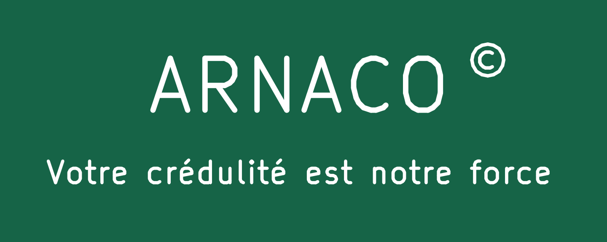

# Shield V2.3 — ARNACO ©, candidat pour cinq prototypes

Mission `TR2-20261105-SHIELD-V23-ARNACO-SILKSCREEN`, départ `e5b15d978585c9c83907942528d60fcaaa913265`. **GO de préparation CAO/exports pour revue ; envoi au fabricant, coûts et paiement soumis à décision humaine.** Aucune qualification physique nouvelle.

Cette variante dérive exclusivement de `../V1_9_C05/`. Le schéma, le projet, toutes les bibliothèques et les empreintes sont copiés à l'identique. Le PCB ne contient que **trois textes supplémentaires sur F.SilkS**, sans autre changement de son expression native :

| Texte | Centre X/Y, mm | Taille / trait, mm |
|---|---|---|
| ARNACO | 61,8 / 88,0 | 2,4 / 0,25 |
| © | 70,5 / 86,8 | 1,1 / 0,16 |
| Votre crédulité est notre force | 61,8 / 92,0 | 1,0 / 0,15 |

Le © est un **glyphe natif réellement exporté**, à droite, plus petit et surélevé. Aucun `(C)` ni police externe. Les accents sont conservés. L'annotation historique `TR2 SHIELD V1.9 DRAFT` reste en place pour identifier la référence électrique ; V2.3 désigne cette personnalisation graphique, pas une nouvelle électronique.



## Emplacement et lisibilité

Zone libre entre microSD et Click, sous la FRAM. Encre ajoutée : X50,154..73,351 / Y85,963..92,530 mm. Aucun recouvrement avec les pads, vias, trous, TP, repères J1–J9, avertissements d'alimentation ou information d'isolement. Le texte reste sur le PCB, sans empiéter sur l'accès microSD ni ajouter de pièce dans le boîtier.

La distance minimale calculée entre cette encre et les ouvertures du masque avant est **4,2166 mm**. Les enveloppes Fab des modules sont dégagées ; un élargissement conservateur de 2,54 mm dans toutes les directions des enveloppes FRAM/SD laisse encore au moins **4,4986 mm** entre le marquage et la SD. Ce calcul couvre le placement de l'encre, **pas l'emboîtement physique des nouveaux connecteurs 1×10** ni un coffret réel. La visibilité depuis l'extérieur d'un boîtier fermé n'est pas revendiquée.

La totalité de la sérigraphie avant conserve une garde minimale calculée de **0,1654 mm** aux ouvertures du masque ; cette garde proche du minimum appartient au marquage historique, pas au logo ajouté. La page [capacités JLCPCB](https://jlcpcb.com/capabilities/Capabilities) annonce 0,15 mm de trait et d'écart pad/sérigraphie. Les nouveaux textes sont de 1,0 mm ou plus et de trait≥0,15. Qualité réelle d'impression, variations de procédé et contrôle de production du fabricant restent à observer.

## Fichiers utiles

- [Projet KiCad éditable](cad/TR2_Shield_Proto_V1.kicad_pro), [PCB](cad/TR2_Shield_Proto_V1.kicad_pcb), [schéma inchangé](cad/TR2_Shield_Proto_V1.kicad_sch).
- [ZIP candidat, neuf fichiers CAM](exports/TR2_SHIELD_V23_5PCB_CANDIDAT_NON_LIBERE.zip), [manifeste SHA-256](preuves/CAM-manifeste.json).
- [Fiche JLCPCB](FICHE_JLCPCB_5_PROTOTYPES.md) et [configuration JSON](configuration-JLCPCB.json), pour la revue et la future décision humaine.
- [Implantation](exports/implantation.png), [cuivre avant](exports/cuivre-dessus.png), [cuivre arrière miroir](exports/cuivre-dessous-miroir.png), PDF vectoriels et schéma dans `exports/`.
- [Sérigraphie complète issue du GTO](exports/serigraphie-depuis-Gerber.png), [détail SVG](exports/ARNACO-CAM-detail.svg). Le rendu Gerber provient des traits effectivement exportés, sans recréer les lettres avec une police de visualisation.

Le ZIP contient **sept Gerber et deux Excellon** : une seule variante, un seul contour, aucun ancien CAM V1.4/V1.8, aucun projet source ni ZIP imbriqué. Les plans de perçage PDF sont fournis séparément. Le `.gbrjob` natif reste informatif hors ZIP : son champ `Size` inclut l'épaisseur du trait de contour (90,05×100,05), alors que les axes du contour donnent bien **90×100 mm** ; son champ `Finish: None` n'est pas un réglage de commande HASL. Ni le contour ni ce fichier natif n'ont été retouchés pour masquer cet écart de métadonnées.

## Contrôles observés

| Contrôle | Résultat |
|---|---|
| KiCad 10.0.6, ERC et DRC stricts avec parité | 0 violation, 0 non-connecté, 0 différence de parité. Règles et listes de contrôles ignorés inchangées. |
| Comparaison native PCB avec V1.9 | Après retrait des trois textes ajoutés : expression complète identique, donc mêmes composants, centres, cuivre, zones, contour, stack et contraintes. |
| Schéma/projet/bibliothèques/design | Copies identiques octet pour octet. |
| Cuivre avant/arrière, masques, contour, sérigraphie arrière, deux Excellon | **Huit fichiers équivalents à V1.9** après retrait des seules dates et normalisation LF ; aucune commande de tracé ou coordonnée retirée de la comparaison. |
| Netlist, attributs X2 et perçages | 59 broches connectées, 19 empreintes, 191 pads, 4 vias ; chaque centre/diamètre vérifié à la résolution Excellon. |
| Sérigraphie avant | 902 traits anciens conservés, 319 traits ajoutés ; tous les ajouts dans les boîtes des trois textes. |
| Rendu réel exporté | © entouré d'un cercle, exposant visible, devise exacte accentuée ; implantation et deux cuivres inspectés. |
| Conservation des acquis | **505 fichiers antérieurs du shield inchangés**, notamment V1.9, V2.0, D126 et V2.2. |

Voir `docs/checks/`, [validation](preuves/validation-finale.json), [équivalence CAM](preuves/CAM-equivalence.json) et [géométrie de sérigraphie](preuves/serigraphie-CAM.json). Les PNG sont des vues de contrôle, jamais des fichiers à fabriquer. Aucun essai firmware, flash ou accès matériel n'a été réalisé.

## Risque prototype et acquisitions de composants

La mission rapporte l'acceptation humaine du risque mécanique résiduel d'un premier lot expérimental. Les réserves ne sont pas transformées en qualification : J5/Zio et G réel, quatre mâles CN12, Connfly1×10 avec corps conservé/patte supplémentaire neutralisée, fixation D126, isolation, modules/étriers et boîtier restent à contrôler **à froid sur le premier assemblage avant alimentation**, sans forcer. Pas de nouvelle impression papier requise par cette personnalisation. La présente étude ne donne aucune consigne de modification physique à exécuter maintenant.

Selon le contrat publié, une commande TME de **17,60 € TTC transport compris** est confirmée par l'utilisateur : 10×1×12, 10×1×10, 10×1×8 Connfly, trois barres mâles2×40, dix résistances10k, trois AVX100n et trois Panasonic10µF. **Ne pas réacheter ces lignes.** Ce sont des informations rapportées dans la mission, pas une réception constatée par Codex. Les échantillons Samtec ont été demandés, réception non vérifiée. Aucun justificatif commercial, identifiant de commande ou donnée personnelle n'est archivé ici.

Les variantes d'assemblage AVX/EEUFR et Connfly1×10 ne sont pas adoptées silencieusement dans les bibliothèques inchangées : les réserves de V2.2, dont l'enveloppe C1, restent à confronter aux pièces réelles. Cette mission graphique ne remplace pas cette vérification.

## Reproduction ciblée

Depuis la racine du worktree, avec KiCad Windows10.0.6 et les bibliothèques Linux déjà présentes :

```bash
V23_DIR="$PWD/Modbus RTU/04_Architecture/SHIELD_PROTO_V1/V2_3_ARNACO"
KICAD_PY='/mnt/c/Program Files/KiCad/10.0/bin/python.exe'
"$KICAD_PY" "$(wslpath -w "$V23_DIR/tools/customize.py")"
python3 "$V23_DIR/tools/export_design.py"
"$KICAD_PY" "$(wslpath -w "$V23_DIR/tools/read_board.py")" "$(wslpath -w "$V23_DIR")"
python3 "$V23_DIR/tools/verify_exports.py"
PYTHONPATH=/home/lolo/dev/msm/cache/shield-pylibs python3 "$V23_DIR/tools/verify_variant.py"
PYTHONPATH=/home/lolo/dev/msm/cache/shield-pylibs python3 "$V23_DIR/tools/render_review.py"
```

Ces scripts écrivent seulement dans le candidat V2.3. Le personnalisateur recharge la source V1.9 et utilise trois UUID déterministes. Les comparateurs ne suppriment aucun contrôle ; le lecteur de sérigraphie échoue sur une commande graphique non prise en charge. Pas de promesse de prise en charge universelle du Gerber. Reproduire les exports change leurs horodatages et donc les empreintes brutes ; utiliser alors le nouveau manifeste cohérent.
